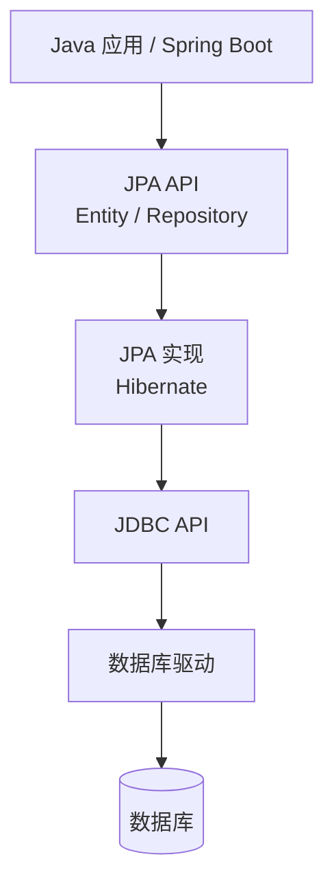
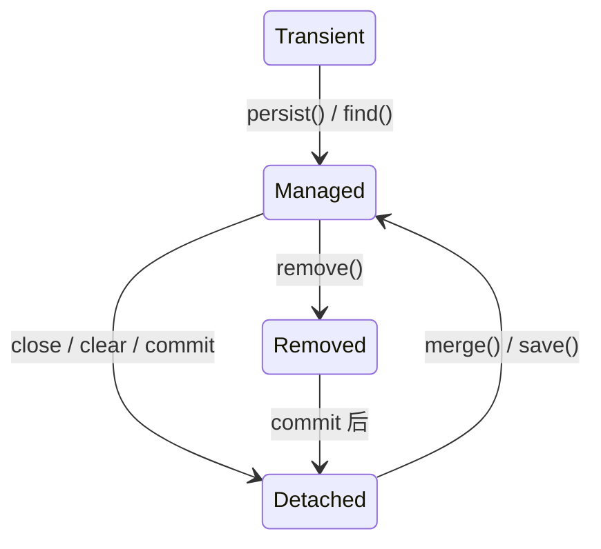

[Spring Data JPA 中文文档](https://springdoc.cn/spring-data-jpa/)

本开源项目：[SpiderK-104/Spring-Data-JPA-Demo: 个人学习JPA](https://github.com/SpiderK-104/Spring-Data-JPA-Demo)
# 1 基础介绍

> Spring Data JPA 在国内是“叫好不叫座”：技术地位上是 JPA 规范的标准实现，国际项目和 DDD 架构中的主流选择；但在国内互联网核心业务中，实际使用率远低于 MyBatis-Plus，因为国内更看重 SQL 的显式可控性而非对象模型的抽象优雅。


**什么是 JPA?**
JPA 全称 Jakarta Persistence API ，是 Sun 公司官方推出的一种 ORM 规范。该规范为我们提供了如下的功能 
1. ORM 映射元数据：JPA 支持 XML 和注解两种元数据的形式。元数据用于描述对象和表的之间的映射关系，框架据此将实体对象持久化到数据库表中；如@Entity,@Table，@Id,@Column
2. JPA 的 API: 用来操作实体对象，执行 CURD.框架在后台替我们完成所有的事情。开发者从繁琐的 JDBC 和 SQL 代码中解脱出来。如 entityManager.merge(T t)
3. JPQL 查询语言：通过面向对象，而非面向数据库的  查询语言查询数据，避免程序的 SQL 语句精密耦合。如 `from Student s where s.name =?`

>Jakarta EE = 原来的 Java EE，只是 Oracle 把商标和治理权移交给了 Eclipse 基金会后，包名从 `javax.*` 改成了 `jakarta.*`。因为Oracle 不允许 Eclipse 基金会继续使用 `javax` 这个包名


JPA 是 JDBC 的升级版本，二者都是一组规范接口，均是由 SUN 公司 官方推出的。
然而不同的地方是：
1. JDBC 是由各个关系型数据库实现的， JPA 是由 ORM 框架实现
2. JDBC 使用 SQL 语句和数据库通信。JPA 用面向对象方式（比如通过 对象.方法 就可以操作数据库），通过 ORM 框架来生成 SQL，进行操作。

注意，JPA 本身 **没有数据库访问能力**，它只定义：
- 注解：`@Entity`、`@Table`、`@Id`、`@Column`、`@OneToMany` …
- 接口：`EntityManager`、`EntityTransaction`
- JPQL（Java Persistence Query Language）
- 生命周期、缓存、事务规则

> 正是因为 JPA 本身没有数据库访问的能力，所以 ，项目中 pom 依赖不仅要引入 spring-data-jpa，还要单独引入 mysql/pgsql 相关 connector

## 1.1 Hibernate 与 JPA

JPA 是标准（接口规范），Hibernate 是实现（ORM 框架）。​就像 JDBC 是标准，MySQL Connector / Oracle Driver 是实现；也像 Servlet 规范 是标准，Tomcat / Jetty 是实现。


SpringData 同时支持 关系型和非关系型数据库。

| 业务场景          | 技术选型                      |
| ------------- | ------------------------- |
| 强一致、事务、复杂业务   | Spring Data JPA / JDBC    |
| 高并发、非阻塞       | Spring Data R2DBC         |
| JSON 结构、字段经常变 | Spring Data MongoDB       |
| 缓存、限流、分布式锁    | Spring Data Redis         |
| 全文搜索、日志检索     | Spring Data Elasticsearch |
| 社交关系、权限路径     | Spring Data Neo4j         |
| 超高写入、海量数据     | Spring Data Cassandra     |
| 云原生、托管服务      | DynamoDB / CosmosDB 模块    |
现在讲 Hibernate ，JPA 之间的关系。
Hibernate 负责：
- 把 Java 对象转成 SQL
- 把 SQL 结果转成对象
- 管理一级/二级缓存
- 懒加载、脏检查、级联
- 方言适配（MySQL / Oracle / PostgreSQL…）

JPA 是 Java 持久化标准，定义对象与关系数据库的映射规范；Hibernate 是 JPA 最主流的实现，提供完整的 ORM 能力；Spring Data JPA 在 JPA 之上进一步封装，让数据访问更简单。生产环境中，通常使用 Spring Data JPA + Hibernate + MySQL/PostgreSQL 的组合。


## 1.2 JDBC 与 JPA

> JDBC 是 Java 访问数据库的最底层标准；JPA 是在 JDBC 之上的一层 ORM 抽象规范，最终仍然通过 JDBC 操作数据库。

| 维度     | JDBC        | JPA                     |
| ------ | ----------- | ----------------------- |
| 定位     | 底层数据库访问 API | ORM 规范（接口标准）            |
| 使用方式   | 手写 SQL      | 面向对象操作（Entity）          |
| SQL 控制 | 完全手动        | 自动生成（可定制）               |
| 实现者    | JDK 自带      | Hibernate、EclipseLink 等 |
| 本质关系   | ✅ 最终执行者     | ✅ 上层封装                  |




# 2 配置详解

项目数据库使用 PgSQL

```xml title:配置环境
<dependency>  
	<groupId>org.postgresql</groupId>  
	<artifactId>postgresql</artifactId>  
	<scope>runtime</scope>  
</dependency>  
  <dependency>  
	<groupId>org.springframework.boot</groupId>  
	<artifactId>spring-boot-starter-data-jpa</artifactId>  
</dependency>
<!--        mysql 驱动-->  
<!--        <dependency>-->  
<!--            <groupId>com.mysql</groupId>-->  
<!--            <artifactId>mysql-connector-j</artifactId>-->  
<!--            <scope>runtime</scope>-->  
<!--        </dependency>-->
```


```yml title:配置文件
spring:
  application:
    name: jpa-learn
  # 数据库配置（PostgreSQL）
  datasource:
    url: jdbc:postgresql://localhost:5432/db_demo
    username: postgres
    password: 123456
    driver-class-name: org.postgresql.Driver
    # 数据库连接池的配置，hikari 连接池的配置
    hikari:
      idle-timeout: 30000
      connection-timeout: 10000
      maximum-pool-size: 15
      minimum-idle: 5
      auto-commit: true
      connection-test-query: SELECT 1
  # JPA 配置
  jpa:
    show-sql: true
    hibernate:
      ddl-auto: update
    database-platform: org.hibernate.dialect.PostgreSQLDialect

server:
  port: 8081
```

### 2.1.1 Hikari 配置参数
👉 从 **Spring Boot 2.0**​ 开始，HikariCP 就是 **默认连接池**，不用引任何额外依赖。HikariCP号称：最快的Java 数据库连接池

**spring.datasource.hikari 配置参数**

| 配置项                | 含义            | 解释                              |
| ------------------ | ------------- | ------------------------------- |
| idle-timeout       | 空闲连接超时时间（ms）  | 连接池里空闲超过这个时间的连接会被回收掉            |
| connection-timeout | 获取连接的超时时间（ms） | 应用从连接池借连接，等了这么久还没拿到就抛异常         |
| maximum-pool-size  | 连接池最大连接数      | 连接池里最多同时存在多少个连接（含空闲+在用）         |
| minimum-idle       | 最小空闲连接数       | 连接池至少保持多少个空闲连接，防止冷启动            |
| auto-commit        | 是否自动提交事务      | 每个 SQL 执行完自动 commit，不手动控制事务时很方便 |

### 2.1.2 jpa 配置参数

以下是 `spring.jpa.hibernate.ddl-auto`
- none 是最"安静"的一个值，配置它之后 Hibernate 在启动阶段完全不会去碰数据库的表结构，不会建表、不会改表、也不会删表，它只负责通过 DataSource 拿到连接然后做 CRUD 操作。
> 这意味着数据库里所有的表、字段、索引都必须提前由你自己（或者 DBA、或者 Flyway/Liquibase 这类迁移工具）建好，而且表结构必须和你的 @Entity 类完全对应，否则运行时会报字段找不到或表不存在的错误。这是生产环境最安全、最推荐的值，因为它把"改表"这件事从应用代码里彻底剥离出去，不会因为一次误部署就把表结构搞乱。

- validate 的意思是"只校验、不动手"——Hibernate 启动时仍然会读取所有 @Entity 的元数据，然后去数据库里逐个比对表是否存在、字段名是否匹配、字段类型是否兼容，如果发现不一致就直接启动失败并抛异常，比如 Table not found 或 Missing column。
> 它和 none 的区别在于：none 是连看都不看，validate 是看了但不改，相当于给表结构做了一道启动时的"安检门"。这个模式非常适合生产环境，因为一旦有人手动改了数据库表结构、或者 Entity 类被误改了，应用启动就能立刻暴露问题，而不是等运行到某个接口才报错。

- update 是开发阶段用得最多的模式，它的核心逻辑是：启动时 Hibernate 会对比 @Entity 和数据库现有表结构，缺表就建表，缺字段就加字段，但绝不会删字段、删表或改字段类型。
> 听起来很美好，但实际上它有几个隐蔽的坑——比如你把字段名从 userName 改成 username，Hibernate 会认为旧字段被删了、新字段是新增的，导致旧数据"丢失"；再比如改字段类型（String → Integer），它不一定能成功迁移，可能直接报错。所以 update 只适合学习、本地开发、原型验证这种表结构频繁变但数据不重要的场景，绝对不要在生产环境用

- create 是最"暴力"的一个值——每次应用启动时，Hibernate 会先把所有表 DROP 掉，再按 @Entity 重新 CREATE，这意味着每次重启，之前所有的数据全部清零。这个模式只适合单元测试或演示场景
 
- create-drop 比 create 还要"极端"一步——它同样是启动时建表，但额外加了一个动作：在应用关闭时把表全部删掉。
> 也就是说，这个数据库的生命周期和应用进程的生命周期完全绑定，应用一停，数据就没了。它特别适合配合内存数据库（如 H2）做集成测试，测试跑完进程结束，连数据库文件一起消失，干干净净。但如果你用的是 MySQL/PostgreSQL 这种真实数据库，配了 create-drop，那每次 Ctrl+C 停服务的时候表就没了，所以它只适合测试环境，而且通常只在测试配置文件中出现，绝不能出现在主配置文件里。

 
这几个配置比较内容如下：

| 组件               | 功能                     | 不管的事             |
| ---------------- | ---------------------- | ---------------- |
| JPA / Hibernate​ | 实体映射、SQL 生成、事务、缓存、懒加载  | 连接怎么创建、怎么复用      |
| HikariCP​        | 创建连接、回收连接、控制最大连接数、心跳检测 | 表结构、SQL 怎么写、字段映射 |


### 2.1.3 系统启动过程

现在我们来分析，hikari ，Hibernate，JPA 三者之间是如何联动的？先把整个过程拆分成 6 个阶段

| 阶段    | 谁在干活         | 干了啥                 |
| ----- | ------------ | ------------------- |
| ① 启动  | Spring Boot  | 读 application.yml   |
| ② 启动  | HikariCP     | 建连接池（不建连接）          |
| ③ 启动  | Hibernate    | 加载 Dialect（方言）      |
| ④ 启动  | Hibernate    | 映射 Entity → 表结构     |
| ⑤ 启动  | Hibernate    | 执行 ddl-auto         |
| ⑥ 运行时 | JPA + Hikari | 你调 repository 时真正查库 |

1. 项目启动后，先读取 application.yml 配置
2. HikariCP 负责启动后立刻建立连接池
3. Hibernate 负责加载 DiaLect，它会根据 database-plateform 找到对应的 Dialect 类。比如 new PostgreSQLDialect ,就会注册进去：Pg 的分页语法、类型映射、主键策略、函数写法。
4. Hibernate 扫描所有带@Entity 的类，然后读取每个类中的@Table,@Id 等注解，以及各个字段建立映射元数据。注意，这一步需要获取第 3 步得到的 Dialect。
5. 执行 ddl-auto：这时候才是真正连接数据库，将第四步建好的映射元数据，我们以 update 参数为例
	- 缺表：create table
	- 缺字段：alter table add column
	- 啥都有就不动
6. 运行时，比如调用 userRepository.findAll()：首先 Hibernate（用 Dialect 语法）会生成 SELECT * FROM users; HikariCP 从连接池中获取数据库连接；JDBC 会把 SQL 发送到数据库；数据库返回结果，HikariCP 还连接给池子。


下面这个是一个很有意思的启动报错，是实际遇到的问题：

| 配置         | 报错                                             | 实际根因                                      |
| ---------- | ---------------------------------------------- | ----------------------------------------- |
| 没配 dialect | Access to DialectResolutionInfo cannot be null | 连不上 DB → 无法自动推断 dialect → 报 dialect 错     |
| 配了 dialect | NoRouteToHost / Unable to open JDBC Connection | 连不上 DB → 直接用指定 dialect → validate 阶段暴露连接错 |

```bash title:配置了dialect时的启动过程
Hibernate 启动
  → 需要 JdbcEnvironment 服务
  → JdbcEnvironment 需要 Dialect
  → dialect 没配 → 尝试自动推断
  → 自动推断需要连 DB 获取数据库元数据
  → 连不上 → Connection 为 null
  → DialectResolutionInfo 为 null
  → 抛异常：Access to DialectResolutionInfo cannot be null
```


```bash title:没有配置dialect时的启动过程
Hibernate 启动
  → 需要 JdbcEnvironment 服务
  → JdbcEnvironment 需要 Dialect
  → dialect 已配 → 直接用 PostgreSQLDialect ✅
  → JdbcEnvironment 创建成功 ✅
  → 继续构建 SessionFactory
  → 执行 ddl-auto: validate
  → validate 需要连 DB 读取表结构
  → 连不上 → NoRouteToHost ❌
```


# 3 实体与关系映射


## 3.1 实体状态

在 JPA（Hibernate）中，**一个 Java 对象在不同阶段会处于不同状态**，JPA 正是通过“状态”来决定要不要同步到数据库。

- Transient 瞬时态
- Managed 持久态
- Detached 游离态
- Removed 删除态

| 状态         | 在 Persistence Context 中？ | 是否有数据库记录 | 是否会被自动同步   |
| ---------- | ------------------------ | -------- | ---------- |
| Transient​ | ❌                        | ❌        | ❌          |
| Manage​    | ✅                        | ✅        | ✅          |
| Detache​   | ❌                        | ✅        | ❌          |
| Remove​    | ✅                        | ✅        | ✅（事务提交时删除） |




**Transient(瞬时态)** 

这种状态往往发生在表单接受参数和 DTO-> Entity初期
- 刚 New 出来的一个对象
- 和 JPA 没有任何关系
- 数据库里面没有对应记录
```java
User user =new User()
user.setName("yf")
```


**Managed(持久态)

特征是：
- 被 **Persistence Context（一级缓存）管理**
- 数据库中有对应记录
- **对象属性变化会自动同步到数据库（脏检查）**

进入 Managed 的方式是：
```java
//方式1
User user = entityManager.find(User.class, 1L);
// 方式2
entityManager.persist(user);
```


```java title:自动更新示例
@Transactional
public void updateName() {
    User user = userRepository.findById(1L).get();
    user.setName("New Name");
    // 没有 save，也会更新数据库
}
```

> 原因：user 处于 Managed 状态，事务提交时 Hibernate 自动执行 UPDATE


**Detached（游离态）**

特征如下：
- 曾经是 Managed
- 但 **Session / Transaction 已关闭**
- 数据库中有记录
- **不会再自动同步**

常见的产生方式：

```java
@Transactional
public User getUser() {
    return userRepository.findById(1L).get();
}
// 方法结束后，user 变成 Detached

// 下面的操作，不会再更新到数据库了
user.setName("秦孝王");
```

如果想要重新同步：
```java
// 方式1
entityManager.merge(user);

// 方式2
userRepository.save(user);
```


**Removed（删除态）**

特征如下：
- 在 Persistence Context 中
- 事务提交时会被 DELETE

```java
User user = userRepository.findById(1L).get();
entityManager.remove(user);
// 或者
userRepository.delete(user);
```

状态变化：Managed → Removed → 数据库删除


## 3.2 实体映射

| 注解                   | 作用               |
| -------------------- | ---------------- |
| @Entity              | 标识这是一个 JPA 实体    |
| @Table(name = "...") | 指定表名             |
| @Id                  | 主键               |
| @GeneratedValue      | 主键生成策略           |
| @Column              | 字段映射（长度、非空、唯一等）  |
| @Enumerated          | 枚举映射             |
| @Lob                 | 大字段（TEXT / BLOB） |
| @CreatedDate         | 创建时间             |
| @LastModifiedDate    | 更新时间             |
| @PrePersist          | 插入前自动填充          |
- 简单项目用 `@PrePersist`
- 正式项目用 `@CreatedDate` + `JpaAuditing`

@GeneratedValue 的核心就一句话：主键由“谁”来生成——数据库、序列、计数表、还是 JVM。
- 单纯的 `@GeneratedValue`，等价于 AUTO，Hibernate 会根据你使用的数据库方言来自己定义。生产环境不推荐。
- `@GeneratedValue(strategy= GenerationType.IDENTITY)` 该注解由**数据库自动生成，主键自增型**，在 mysql 数据库中使用**最频繁**，oracle 不支持；pgsql 支持，它底层是通过 sequence 实现。
- `@GeneratedValue(strategy= GenerationType.SEQUENCE)` 根据底层数据库的序列来生成主键，条件是数据库支持序列，Oracle/PgSQL 支持，Mysql 不支持。
- `@GeneratedValue(strategy= GenerationType.TABLE) `使用一个特定的数据库表格来保存主键，较少使用。
- `@GeneratedValue(strategy = GenerationType.UUID)`：支持批量插入，分布式系统/微服务友好。代价就是索引比 BIGINT 大

| 策略       | MySQL    | PostgreSQL | Oracle     | 批量插入  | 推荐度       |
| -------- | -------- | ---------- | ---------- | ----- | --------- |
| AUTO     | IDENTITY | SEQUENCE   | SEQUENCE   | 看情况   | 2⭐（学习用）   |
| IDENTITY | ✅ 最佳     | ✅ 可用       | ⚠️ 12c+ 才行 | ❌ 不支持 | 4⭐（MySQL） |
| SEQUENCE | ⚠️ 不主流   | ✅ 最佳       | ✅ 最佳       | ✅ 支持  | 5⭐        |
| TABLE    | ✅        | ✅          | ✅          | ✅     | 2⭐（别随便用）  |
| UUID     | ✅        | ✅          | ✅          | ✅     | 4⭐（分布式）   |


## 3.3 关系映射

| 关系  | 注解          | 谁使用          |
| --- | ----------- | ------------ |
| 1:1 | @OneToOne   | 两边都可以        |
| 1:N | @OneToMany  | “一”的一方       |
| N:1 | @ManyToOne  | “多”的一方       |
| N:N | @ManyToMany | 任意一方（但只一方维护） |
>  一个最重要的一点：外键永远是在“多”的一方

```bash
User       1 ──── N  Order
Order      1 ──── N  OrderItem
OrderItem  N ──── 1  Product
```
- Order.user_id
- OrderItem.order_id
- OrderItem.product_id


| 概念          | 说明                 |
| ----------- | ------------------ |
| mappedBy    | 我不维护外键，外键在那边       |
| cascade     | 级联操作               |
| fetch       | 加载方式（LAZY / EAGER） |
| @JsonIgnore | 防止 JSON 死循环        |


### 3.3.1 mappedBy


### 3.3.2 cascade


| 类型      | 含义                |
| ------- | ----------------- |
| PERSIST | 保存父 → 保存子         |
| MERGE   | 更新父 → 更新子         |
| REMOVE  | 删除父 → 删除子         |
| REFRESH | 刷新父 → 刷新子         |
| DETACH  | 脱离 Session → 子也脱离 |
| ALL     | 上面全部              |

```java title:示例
@OneToMany(mappedBy = "user", cascade = CascadeType.ALL, orphanRemoval = true)
private List<Order> orders;
```
- 保存 user → 自动保存 orders
- 删除 user → 自动删除 orders
- 从 orders 列表移除 → 自动删除该 order

注意：cascade 只在“通过父对象操作子对象”时生效。

```java
// ✅ 生效
user.addOrder(order);
userRepository.save(user);

// ❌ 不生效
orderRepository.save(order);
```

### 3.3.3 fetch

fetch 参数用来决定什么时候把关联数据查出来。

| 类型    | 行为   |
| ----- | ---- |
| EAGER | 立刻查  |
| LAZY  | 用到才查 |
Fetch 在以下几种情况的默认值是，但是这并不代表下面的默认值就是正确的！

| 注解          | 默认 fetch |
| ----------- | -------- |
| @ManyToOne  | EAGER    |
| @OneToOne   | EAGER    |
| @OneToMany  | LAZY     |
| @ManyToMany | LAZY     |

LAZY 的经典坑：LazyInitializationException
```java
Order order = orderRepository.findById(1L);
return order.getUser().getName(); // ❌
```
它会报错：could not initialize proxy - no Session

这是因为：- Service 方法结束 → Session 关闭。- 在 Controller 才访问 LAZY 属性


1️⃣ @ManyToMany 为什么生产里要拆成两个 @OneToMany​

2️⃣ mappedBy + cascade + orphanRemoval 联合实战案例​

3️⃣ 用 Hibernate SQL 日志，看 LAZY 到底什么时候发 SQL​

4️⃣ JPA 关系映射“避坑清单”（面试级）


### 3.3.4 JsonIgnore

## 3.4 实体与关系映射示例

下面给一个用户、订单、订单项、产品 关系实体类，去分析如何使用的。

```bash
User
 └── 1:N ── Order
              └── 1:N ── OrderItem
                           └── N:1 ── Product
```

```java title:User表
package com.yf.jpalearn.entity;  
import jakarta.persistence.*;  
import lombok.Data;  
import lombok.Getter;  
import lombok.NoArgsConstructor;  
import lombok.Setter;  
import org.springframework.data.annotation.CreatedDate;  
import org.springframework.data.jpa.domain.support.AuditingEntityListener;  
import java.time.LocalDateTime;  
import java.util.ArrayList;  
import java.util.List;  
  
/**  
 * 用户表 ：User:Order=1：N
 */  
@Entity  
@Table(name = "users")  
@Data  
@NoArgsConstructor  
@EntityListeners(AuditingEntityListener.class)  
public class User {  
  
    @Id  
    @GeneratedValue(strategy = GenerationType.IDENTITY)  
    private Long id;  
  
    @Column(nullable = false, length = 50)  
    private String username;  
    /**  
     * mappedBy 映射关系的反向引用属性: 订单表中的 user_id 字段  
     * cascade = CascadeType.ALL: 级联删除, 当用户被删除时, 其关联的所有订单也会被删除  
     * orphanRemoval = true: 级联删除, 当订单被删除时, 其关联的用户也会被删除  
     */  
    @OneToMany(mappedBy = "user", cascade = CascadeType.ALL, orphanRemoval = true)  
    private List<Order> orders = new ArrayList<>();  
  
    @CreatedDate  
    @Column(updatable = false)  
    private LocalDateTime createdAt;  
}
```


```java title:Order
package com.yf.jpalearn.entity;  
  
import jakarta.persistence.*;  
import lombok.Getter;  
import lombok.NoArgsConstructor;  
import lombok.Setter;  
import org.springframework.data.annotation.CreatedDate;  
import org.springframework.data.jpa.domain.support.AuditingEntityListener;  
  
import java.time.LocalDateTime;  
import java.util.ArrayList;  
import java.util.List;  
  
/**  
 * 订单表: User -> Order -> OrderItem  
 * 订单表与用户表是 1:N关系, 订单表与订单明细表是1:N关系.  
 */@Entity  
@Table(name = "orders")  
@Getter  
@Setter  
@NoArgsConstructor  
@EntityListeners(AuditingEntityListener.class)  
public class Order {  
  
    @Id  
    @GeneratedValue(strategy = GenerationType.IDENTITY)  
    private Long id;  
    /**  
     * 订单所属的用户  
     * ManyToOne 关联关系, 一个订单只能属于一个用户.  
     */    @ManyToOne(fetch = FetchType.LAZY)  
    @JoinColumn(name = "user_id", nullable = false)  
    private User user;  
  
    /**  
     * 订单明细列表  
     * OneToMany 关联关系, 一个订单可以有多个订单明细.  
     */    @OneToMany(mappedBy = "order", cascade = CascadeType.ALL, orphanRemoval = true)  
    private List<OrderItem> items = new ArrayList<>();  
  
    @CreatedDate  
    private LocalDateTime createdAt;  
  
    /**  
     * 添加订单明细 到订单明细列表  
     *  
     * @param item 订单明细  
     */  
    public void addItem(OrderItem item) {  
        items.add(item);  
        item.setOrder(this);  
    }  
}
```


```java title:OrderItem
package com.yf.jpalearn.entity;  
  
import jakarta.persistence.*;  
import lombok.Data;  
import lombok.NoArgsConstructor;  
  
/**  
 * 订单明细（中间表）  
 * User
 └── 1:N ── Order
              └── 1:N ── OrderItem
                           └── N:1 ── Product
 */  
@Entity  
@Table(name = "order_items")  
@Data  
@NoArgsConstructor  
public class OrderItem {  
  
    @Id  
    @GeneratedValue(strategy = GenerationType.IDENTITY)  
    private Long id;  
    /**  
     * 订单明细所属的订单  
     * ManyToOne 关联关系, 一个订单明细可以属于一个订单.  
     */    @ManyToOne(fetch = FetchType.LAZY)  
    @JoinColumn(name = "order_id")  
    private Order order;  
  
    @ManyToOne(fetch = FetchType.LAZY)  
    @JoinColumn(name = "product_id")  
    private Product product;  
  
    private Integer quantity;  
}
```


```java title:Product
package com.yf.jpalearn.entity;  
import jakarta.persistence.*;  
import lombok.Data;  
import lombok.NoArgsConstructor;  
import java.math.BigDecimal;  
@Entity  
@Table(name = "products")  
@Data  
@NoArgsConstructor  
/**
*
User
 └── 1:N ── Order
              └── 1:N ── OrderItem
                           └── N:1 ── Product
*/
public class Product {  
    @Id  
    @GeneratedValue(strategy = GenerationType.IDENTITY)  
    private Long id;  
    @Column(nullable = false)  
    private String name;  
    private BigDecimal price;  
}
```


# 4 Spring Data JPA 集成

公司项目大多是 Springboot + JPA


JPA 提供自动的方法：

| 方法名称           | 含义       |
| -------------- | -------- |
| findById(id)   | 根据 Id 查询  |
| save(entity)   | 保存/更新实体类 |
| deleteById(id) | 根据 Id 删除  |
自定义查询方法（JPA 方法命名规范）：
```java
// 自动生成 SQL
// SELECT * FROM kms_device_cert WHERE sign_alg_name = ? AND dn = ? AND category = ?
Optional<KmsDeviceCertEntity> findBySignAlgNameAndDnAndCategory(String signAlgName, String dn, CertCategoryEnum category);
```


### 4.1.1 Entity 


#### 4.1.1.1 BaseEntity

BaseEntity 是一个 JPA 实体基类。
- 通过 @MappedSuperclass 让所有继承它的实体类自动获得通用字段（id、创建时间、更新时间等）。
- 配合 @EntityListeners(AuditingEntityListener.class) 实现审计字段的自动填充。

*完整代码*

```java
@Getter
@Setter
@ToString
@RequiredArgsConstructor
@Accessors(chain = true)
@MappedSuperclass
@EntityListeners(AuditingEntityListener.class)
public class BaseEntity implements Serializable {
    private static final long serialVersionUID = -7741013587776189187L;
    @GeneratedValue(strategy = GenerationType.IDENTITY)
    @Id
    @Column(name = "id")
    private Long id;
    @JsonFormat(pattern = "yyyy-MM-dd HH:mm:ss", timezone = "GMT+8")
    @Column(name = "create_time", updatable = false)
    @CreatedDate
    private LocalDateTime createTime;
    @CreatedBy
    @Column(name = "create_user")
    private Long createUser;
    @JsonFormat(pattern = "yyyy-MM-dd HH:mm:ss", timezone = "GMT+8")
    @Column(name = "update_time")
    @LastModifiedDate
    private LocalDateTime updateTime;
    @LastModifiedBy
    @Column(name = "update_user")
    private Long updateUser;
    @Column(name = "deleted")
    private Boolean deleted = false;
}
```

比如当：执行 VsmInfoEntity vsmInfo = this.vsmManagementRepository.save(vsmInfoEntity);的时候，
JPA 会自动：
- 设置 createTime = 当前时间（@CreatedDate）
- 设置 createUser = 当前登录用户 ID（@CreatedBy，从 PartnerAuditorAware 获取）
- 设置 updateTime = 当前时间（@LastModifiedDate）
- 设置 updateUser = 当前登录用户 ID（@LastModifiedBy，从 PartnerAuditorAware 获取）
这就是为什么在第 327 行会看到手动设置 setUpdateUser(-1L)，这通常用于非用户操作的场景（如系统自动更新）。

*工作流程*
- 需要先在 BaseEntity 上面添加注解：@EnableJpaAuditing
- 子类实体继承 BaseEntity，自动拥有 id、createTime、updateTime 等字段，当执行 save/update 操作时，JPA 的 AuditingEntityListener 监听器被触发
- 监听器自动设置 @CreatedDate、@CreatedBy、@LastModifiedDate、@LastModifiedBy 标注的字段
- 需要配合 @EnableJpaAuditing 启用审计功能才能生效

*常用注解字段*

| 注解名称                                           | 作用                      |
| ---------------------------------------------- | ----------------------- |
| @Accessors(chain = true)                       | setter 方法返回 this，支持链式调用 |
| @MappedSuperclass                              | 标记为映射超类，字段映射到子类对应的数据库表中 |
| @EntityListeners(AuditingEntityListener.class) | 注册审计监听器，自动处理审计字段        |
| @GeneratedValue(strategy=GenerationType.xx)    | 主键自增策略，依赖数据库自增功能        |
| @Id                                            | 标记为主键字段                 |
| @Column(name = "xx")                           | 指定数据库类名为 xx             |
| @CreatedDate                                   | 自动填充创建时间                |
| @CreatedBy                                     | 自动填充创建人 ID              |
| @LastModifiedDate                              | 自动填充最后修改时间              |
| @LastModifiedBy                                | 自动填充最后修改人 ID            |
关键依赖：
- 需要在配置类上添加 @EnableJpaAuditing 启用审计功能
- @CreatedBy 和 @LastModifiedBy 需要配置 AuditorAware Bean 来获取当前用户

**AuditorAware**

项目中的 PartnerAuditorAware 就是用来配合 BaseEntity 中 @CreatedBy 和 @LastModifiedBy 注解工作的。

```java
/**
 * JPA 自动插入用户ID
 * @author Moriarty
 * @date 2023/9/4 13:26
 * @since 1.0.0
 **/
@Component
public class PartnerAuditorAware implements AuditorAware<Long> {
    @Override
    public Optional<Long> getCurrentAuditor() {
        Long currentUserId;
        try {
            currentUserId = SecurityUtils.getCurrentUserId();
        }catch (Exception e){
            currentUserId = -1L;
        }
        return Optional.of(currentUserId);
    }
}
```


工作原理如下：

```
用户发起请求 → Spring Security 认证 → 用户信息存入上下文 
    ↓
执行 save/update 操作 → AuditingEntityListener 监听器触发
    ↓
调用 PartnerAuditorAware.getCurrentAuditor() → 获取当前用户 ID
    ↓
自动填充到 @CreatedBy/@LastModifiedBy 标注的字段
```

参数说明：

| 元素                                 | 说明                                     |
| ---------------------------------- | -------------------------------------- |
| impletements AuditorAware `<Long>` | 泛型 Long 表示审计字段的类型                      |
| getCurrentAuditor()                | 和新方法，返回当前操作用户的 ID                      |
| SecurityUtils.getCurrentUserId()   | 从 SpringSecurity 上下文中获取当前登录 ID         |
| Optional `<Long>`                  | 返回值包装为 Optional,避免 null 值，因为 null 会抛异常 |
| -1L                                | 异常时的默认值（如未登录）                          |
完整链路：
- 启用审计：Bootstrap.java 上的 @EnableJpaAuditing 开启 JPA 审计功能
- 注册监听器：BaseEntity 上的 @EntityListeners(AuditingEntityListener.class) 注册审计监听器
- 提供用户信息：PartnerAuditorAware 实现 AuditorAware 接口，提供当前用户 ID
- 自动填充：执行数据库操作时，监听器自动调用 getCurrentAuditor() 填充审计字段

#### 4.1.1.2 普通 Entity

其他类只需要继承 BaseEntity 即可。
```java
@RequiredArgsConstructor
@Accessors(chain = true)
@Table(name = "chsm_vsm_info", schema = "public")
public class VsmInfoEntity extends BaseEntity implements Serializable {
```

| 注解名               | 作用                                         |
| ----------------- | ------------------------------------------ |
| @ToString.Exclude | 在生成 toString() 方法时排除该字段，避免循环引用或敏感信息泄露。     |
| @Basic            | PA 字段的默认注解（可省略）。一般声明，就是：配置 fetch 属性控制加载策略。 |

这里说说 @Basic 里面可用参数的含义：

| 参数名      | 类型        | 默认值             | 可选值        | 说明           |
| -------- | --------- | --------------- | ---------- | ------------ |
| fetch    | FetchType | FetchType.EAGER | EAGER/LAZY | 控制字段的加载策略    |
| optional | boolean   | true            | true/false | 字段是否可以为 null |
下面是 fetch 参数详解：

| 值               | 含义                                   | 适用场景                                     |
| --------------- | ------------------------------------ | ---------------------------------------- |
| FetchType.EAGER | 立即加载：查询实体时，该字段会立即从数据库加载到内存           | 适用于大部分普通字段 String、Integer 等              |
| FetchType.LAZY  | 延迟加载：只有当你调用 getter 方法使用该字段时，才会去数据库查询 | 适用于大字段(如 BLOB、CLOB、长文本、二进制数据)，避免不必要的性能开销 |
对于基本数据类型（String、Integer、Long 等），Hibernate 等 JPA 实现通常不会真正执行 LAZY 加载，即使设置了 FetchType.LAZY，也会在查询时一并加载。LAZY 真正生效的场景主要是：
- @Lob 标注的大对象字段
- 关联关系（@ManyToOne、@OneToMany 等）
所以在你的项目中，看到的大部分 @Basic 都没有显式指定参数，因为默认行为已经满足需求

### 4.1.2 Repository 

这是 JPA 的 数据访问层。Repository 的运行时代理机制：Spring Data JPA 在启动时会扫描所有继承 BaseRepository 的子接口（如 SysUserRepository extends BaseRepository<SysUser, Long>），然后：
- 为每个子接口生成一个动态代理对象
- 代理对象内部使用 SimpleJpaRepository 作为实际执行者
- 通过反射解析方法名或 @Query 注解，生成对应的 SQL


### 4.1.3 BaseRepository
这是一个复合接口，通过多重继承整合了 Spring Data JPA 的核心功能。


*核心注解*

| 注解名               | 作用位置          | 含义                                                |
| ----------------- | ------------- | ------------------------------------------------- |
| @NoRepositoryBean | 类级别           | 标记为抽象父接口，Spring 不会为它创建实现类实例，只作为其他 Repository 的父接口 |
| @Transactional    | 方法级别<br>      | 开启事务管理，保证数据操作的原子性                                 |
| @Query            | 方法级别          | 自定义 JPQL 查询语句，替代默认生成的 SQL                         |
| @Modifying        | 方法级别          | 标识该方法执行的是更新/删除操作（非查询）                             |
| @Param("ids")     | 参数级别          | 为方法参数命名，与 JPQL 中的 :ids 占位符绑定                      |
| readOnly = true   | Transactional | 优化性能：只读事务不需要写锁，提升并发能力                             |

继承类的类型。

| 名称                             | 定义                |
| ------------------------------ | ----------------- |
| JpaRepository<T, ID>           | 提供完整的 CRUD + 分页排序 |
| CrudRepository<T, ID>          | 基础 CRUD 操作        |
| JpaSpecificationExecutor `<T>` | 动态条件查询            |
<T, ID> 是 **Java 泛型（Generics）** 的写法

- T 代表要操作的 JPA 实体类，例如 User,Card，Cert 等业务实体；在具体使用的时候，会被实际的实体类替换。
- ID extends Serializable 是主键类型，代表该实体的主键（ID）数据类型，注意，JPA 规范要求主键必须实现 Serializable 接口。ID 常见的类型有 Long、String、Integer、UUID 等


完整代码：

```java

/**
 * @author moriarty
 */
@NoRepositoryBean
public interface BaseRepository<T, ID extends Serializable> extends JpaRepository<T, ID>, CrudRepository<T, ID>, JpaSpecificationExecutor<T> {

    @Override
    @Transactional
    @Query("select e from #{#entityName} e where e.deleted = false ")
    List<T> findAll();
    @Override
    @Transactional(readOnly = true)
    @Query("select e from #{#entityName} e where e.id in ?1 and e.deleted = false")
    List<T> findAllById(Iterable<ID> ids);
    @Override
    @Transactional(readOnly = true)
    @Query("select e from #{#entityName} e where e.id = ?1 and e.deleted = false")
    Optional<T> findById(ID id);
    @Override
    @Transactional(readOnly = true)
    @Query("select count(e) from #{#entityName} e where e.deleted = false")
    long count();
    @Override
    @Transactional(readOnly = true)
    default boolean existsById(ID id) {
        return findById(id).isPresent();
    }
    /**
     * 逻辑删除，需要表有deleted 字段
     *
     * @param id id
     * @return 删除数量
     */
    @Query("update #{#entityName} e set e.deleted = true where e.id = ?1")
    @Transactional
    @Modifying
    int logicalDelete(ID id);
    /**
     * 批量逻辑删除
     *
     * @param ids ids
     * @return 删除数量
     */
    @Query("update #{#entityName} e set e.deleted = true where e.id in :ids")
    @Modifying
    @Transactional
    int logicalDeleteInBatch(@Param("ids") Iterable<ID> ids);
}
```

### 4.1.4 Specification

Specification 是 Spring Data JPA 提供的一个动态查询条件构建工具。简单说：它可以让你在代码运行时，根据不同条件动态组合 SQL 查询语句。


当你使用 Specification 时，会接触到三个"神秘"参数：

| 对象名                       | 含义    | 映射关系            |
| ------------------------- | ----- | --------------- |
| Root `<T> ` root          | 实体根   | FROM table      |
| CriteriaQuery `<?>` query | 查询对象  | SELECT ... FROM |
| CeriteriaBuilder cb       | 条件构造器 | WHERE           |
```java
Specification<KmsDeviceCertEntity> spec = (root, query, criteriaBuilder) -> {
    // root:    代表实体的"根"，可以获取实体的所有属性
    // query:   CriteriaQuery，代表查询本身，可以设置排序、分组等
    // criteriaBuilder: 条件构建器，用来创建各种查询条件
    return null;
};
```

criteriaBuilder 可以创建各种条件，criteriaBuilder 是"条件工厂"，Predicate 是它生产出来的"条件产品"。

| 方法                                    | 作用               | 生成的 SQL                         |
| ------------------------------------- | ---------------- | ------------------------------- |
| equal(root.get("name"), value)        | 等于               | WHERE name = ?<br>              |
| notEqual(root.get("name"), value)     | 不等于              | WHERE name <> ?<br>             |
| like(root.get("name"), "%"+value+"%") | 模糊查询             | WHERE name LIKE ?<br>           |
| greaterThan(root.get("age"), 18)      | 大于               | WHERE age > ?<br>               |
| isNull(root.get("email"))             | 为空               | WHERE email IS NULL<br>         |
| in(root.get("status"), list)          | 包含在列表中           | WHERE status IN (?, ?, ...)<br> |
| cb.and(predicate1, predicate2)        |                  | predicate1 AND predicate2       |
| cb.or(predicate1, predicate2)         |                  | predicate1 OR predicate2        |
| cb.conjunction()                      | 恒真条件（1=1），作为条件容器 | WHERE 1=1                       |

**Predicate - 谓词**

代表一个或多个条件的组合，最终构成 WHERE 子句。

```java
Predicate predicate = cb.conjunction();  // 创建空条件
predicate.getExpressions().add(cb.equal(...));  // 添加条件
return predicate;  // 返回完整条件
```


案例 1：用户分页查询（当前文件第 99-114 行）

```java
Page<SysUserEntity> all = this.userRepository.findAll(
    (Specification<SysUserEntity>) (root, query, cb) -> {
        // 步骤 1：创建条件容器（相当于 WHERE 1=1）
        Predicate predicate = cb.conjunction();
        // 步骤 2：动态添加条件
        if (StringUtils.hasText(queryDTO.getUsername())) {
            // username LIKE '%xxx%'
            predicate.getExpressions().add(
                cb.like(root.get("username"), "%" + queryDTO.getUsername() + "%")
            );
        }
        if (queryDTO.getStatus() != null) {
            // status = ?
            predicate.getExpressions().add(
                cb.equal(root.get("status"), queryDTO.getStatus())
            );
        }
        if (queryDTO.getStartTime() != null) {
            // create_time >= ?
            predicate.getExpressions().add(
                cb.greaterThanOrEqualTo(root.get("createTime"), queryDTO.getStartTime())
            );
        }
        if (queryDTO.getEndTime() != null) {
            // create_time <= ?
            predicate.getExpressions().add(
                cb.lessThanOrEqualTo(root.get("createTime"), queryDTO.getEndTime())
            );
        }
        // 步骤 3：去重
        query.distinct(true);
        // 步骤 4：返回条件
        return predicate;
    }, 
    PageRequest.of(queryDTO.getPageNum(), queryDTO.getPageSize(),
        Sort.by(Sort.Order.asc(orderBy)))
);
```


### 4.1.5 Optional 实战

**从 NullPointerException 说起**

Java 里最烦人的异常是什么？NullPointerException。你永远不知道一个返回值是不是 null，不检查就直接调方法就炸了。到处 if (obj != null) 又让代码又臭又长。Optional 就是为了解决这个问题而生的——它把"可能为空"这个信息显式地写在类型签名里，强迫调用者思考 null 的情况。
Optional 它本质上是一个容器，可能包含值，也可能是空的。你不直接操作值，而是通过 Optional 的方法来安全地操作。

核心心法只有一句话：把 null 逼到系统边缘。
- Repository 层把结果包装成 Optional
- Service 层用 map/flatMap 链式传递
- 最外层 Controller 才用 orElse 取出最终值。
中间的每一环都不需要写一行 if-null。

创建 Optional 的方式只有三种：确定不为 null 时用 of，可能为 null 时用 ofNullable（最常用的），需要手动创建一个空容器用 empty。

```java
Optional<String> opt1 = Optional.of("hello");  // 确定不为null时使用
Optional<String> opt2 = Optional.ofNullable(someVar); // 可能为null
Optional<String> opt3 = Optional.empty();	
```

注意 of(null) 会直接抛 NullPointerException，所以日常开发基本上只碰 ofNullable。

**项目实际使用**

项目中 BaseRepository 覆盖了 JPA 默认的 findById，把返回值明确定义为 Optional：

```java
@Query("select e from #{#entityName} e where e.id = ?1 and e.deleted = false")
Optional<T> findById(ID id);
```

自定义的 Repository 查询方法也统一返回 Optional，这是项目中的约定。比如 KmsKeyInuseRepository 中的自定义查询：

```java
Optional<KmsKeyInuseEntity> findByCaCertSerialAndUserCertSerial(String caCertSerial, String userCertSerial);
```

Spring Data JPA 的方法名派生查询和 @Query 注解查询都天然支持 Optional 作为返回类型。这是 Spring 对 Optional 的第一层集成。

取值其实有四种套路

拿到 Optional 之后怎么取出值来？看项目中哪一种场景最多——"找不到就抛异常"：

```java
// 项目中最常见的模式，用 isPresent + get 手动判断
Optional<KmsKeyInuseEntity> inUserEntityOpt = this.kmsKeyInuseRepository
    .findByCaCertSerialAndUserCertSerial(caCertSerialNumber.toString(), userCertNo.toString());
if (!inUserEntityOpt.isPresent()) {
    return this.errRespond(KMErrorCode.KEY_NOT_EXISTS_ERROR.getCode(), "要撤销的密钥不存在");
}
```

这种写法在项目中占据了绝大多数位置，光是 DesignApiKeyServiceImpl 一个文件就出现了五六次。不过 isPresent + get 本质上回到了 if-null 的老路，可以用 orElseThrow 更简洁地表达：

```java
KmsKeyInuseEntity entity = this.kmsKeyInuseRepository
    .findByCaCertSerialAndUserCertSerial(...)
    .orElseThrow(() -> new PqcCommonException("要撤销的密钥不存在"));
```

三行变一行，意图也更明确——"查找并取出，找不到就抛异常"。

其他几种取值方式：

```java
// 没值时给默认值（默认值提前算好）
String name = opt.orElse("默认名");

// 没值时惰性计算默认值（默认值需要查数据库或调接口时用）
String name = opt.orElseGet(() -> expensiveCompute());

// 有值就消费，没值不做事
opt.ifPresent(val -> log.info("找到了：{}", val));
```

orElse 和 orElseGet 的核心区别一定要搞清楚。orElse 不管 Optional 有没有值，默认值都会先计算出来。如果默认值是通过一个方法算出来的，那这个方法每次都会执行，即使 Optional 有值用不上它。orElseGet 只有 Optional 为空时才执行 Lambda，适合耗时的默认值计算。项目中 UcspConfigServiceImpl 就是用 orElseGet 实现"存在就更新，不存在就新建"：

```java
SysConfigEntity sysConfigEntity = Optional.ofNullable(
    this.sysConfigService.getConfigEntityByKey(SysConfigKeyConstants.UcspConfig.COMMON_CONFIG))
    .map(entity -> {
        entity.setConfigValue(ucspConfigValue);
        return entity;
    })
    .orElseGet(() -> new SysConfigEntity()
        .setConfigKey(SysConfigKeyConstants.UcspConfig.COMMON_CONFIG)
        .setConfigValue(ucspConfigValue));
```

如果数据库中已有配置，map 里的 Lambda 执行更新，orElseGet 不执行。如果数据库中没有，map 不会执行（因为 Optional 是 empty），跳转到 orElseGet 创建新实体。新实体的构造开销只在真正需要时才发生。

map 和 flatMap 是 Optional 的精髓，它的作用是 **"有值就转换，没值就跳过"**

```java
Optional<Integer> length = opt.map(String::length);
```

比如说，现在要写一个方法：传入一个学生对象，返回他的班级编号。如果学生为 null，或者他没有班级，就返回 "未知班级"。
```java title:常规写法
public String getClassId(Student student) {
    if (student != null) {
        ClassRoom room = student.getClassRoom();
        if (room != null) {
            return room.getClassId();
        }
    }
    return "未知班级";
}
```


一条链，干净利落。链中任意一环返回 null，后续的 map 都不再执行，直接跳到 orElse。
```java title:链式写法
public String getClassId(Student student) {
    return Optional.ofNullable(student)          // 可能为null的学生
            .map(Student::getClassRoom)          // 取教室，可能为null
            .map(ClassRoom::getClassId)          // 取班级编号，可能为null
            .orElse("未知班级");                   // 任一环节为null就走这里
}
```
实际上，原有的逻辑设计里面是先看 stu 有没有数据，有就获取 classRoom，获取到后再传 classId。虽然链式表达式让我们感觉看起来是“平行”的逻辑，但是 `.map(Student::getClassRoom)` 并不是"平行地"处理 student，而是先处理 student，拿到结果，再把结果传给下一个 map。


项目中 UcspConfigServiceImpl 就是这种模式的简化版：
```java
Optional.ofNullable(this.sysConfigService.getConfigEntityByKey(...))
    .map(entity -> { 
    entity.setConfigValue(ucspConfigValue); 
    return entity; 	// 如果有则更新这个已有的Config数据
    })
    .orElseGet(() -> new SysConfigEntity()...);	//没有则直接走创建
```

map 在这里的效果：如果查到了配置，就更新它的值然后继续往下走；如果没查到，map 不执行，直接跳到 orElseGet。

**什么是 flatMap？**
假设你有一个盒子（Optional），里面可能有一张纸条，纸条上写着一个保险柜的密码。
```java title:原有写法
// 你有一个盒子，里面可能有纸条
Optional<String> box = Optional.of("密码是123456");
// map：你打开盒子，拿到纸条，然后把纸条整个放进了新盒子
Optional<Optional<String>> result = box.map(str -> {
    // 这个操作返回的是一个 Optional（因为可能找不到保险柜）
    return Optional.of("保险柜打开了：" + str);
});
// 结果变成了：盒子套盒子
// [ [ "保险柜打开了：密码是123456" ] ]
```

```java title:使用faltMap后的写法
Optional<String> box = Optional.of("密码是123456");
// flatMap：你打开盒子，拿出纸条，直接用纸条去开保险柜
Optional<String> result = box.flatMap(str -> {
    // 这个操作返回的还是 Optional，但 flatMap 会自动拆掉一层盒子
    return Optional.of("保险柜打开了：" + str);
});
// 结果只有一层盒子
// [ "保险柜打开了：密码是123456" ]
```

一句话总结：当你处理的方法返回的是 `Optional<T>` 而不是 T 时，就用 flatMap 避免产生 `Optional<Optional<T>> ` 这种嵌套结构。

当你的转换方法本身返回的就是 Optional，map 会导致嵌套：
```java
Optional<Optional<Role>> nested = findById(1L).map(user -> findRoleByUser(user));
```

flatMap 帮你展平这一层包装：
```java
Optional<Role> flat = findById(1L).flatMap(user -> findRoleByUser(user));
```

项目中 Repository 的 findByKeySerial 方法返回的是 Optional，如果你用它进一步查询，就应该考虑 flatMap。
```java title:举个例子
// ✅ 应该用 flatMap
Optional<Role> r1 = findById(1L).flatMap(user -> findRoleByUser(user));
// findRoleByUser 返回 Optional<Role>

// ✅ 应该用 map
Optional<String> r2 = findById(1L).map(user -> user.getUsername());
// getUsername 返回 String，不是 Optional

// ❌ 如果用错了
Optional<Optional<Role>> wrong = findById(1L).map(user -> findRoleByUser(user));
// map 把 Optional<Role> 又包了一层，变成 Optional<Optional<Role>>
```

**filter 用于条件过滤**

filter 接收一个判断条件，不满足就变 empty。项目 LogServiceImpl 的 verifyLog 方法就是典型场景：
```java
public boolean verifyLog(Long logId) {
    Optional<SysLogEntity> logEntityOptional = this.sysLogRepository.findById(logId);
    return logEntityOptional
        .filter(sysLogEntity -> Objects.equals(logHash(sysLogEntity), sysLogEntity.getDigest()))
        .isPresent();
}
```

三步连在一起：查日志，过滤出 hash 匹配的，然后问"是否存在且匹配"。日志不存在或 hash 不匹配都返回 false。没有一行 if 判断。

**ifPresent 处理副作用**

有值就消费，没值就跳过。项目 RedisUtils 的 multiGet 方法用了嵌套的 ifPresent：

```java
public static List<Object> multiGet(List<String> keys) {
    List list = redisTemplate.opsForValue().multiGet(...);
    List resultList = new ArrayList();
    Optional.ofNullable(list).ifPresent(e -> list.forEach(ele ->
        Optional.ofNullable(ele).ifPresent(resultList::add)));
    return resultList;
}
```

外层 Optional 包裹整个 list，不为 null 才遍历。内层 Optional 包裹每个元素，不为 null 才加入结果列表。整个方法不需要写一行 if (list != null)。

Spring 内的深度集成：JPA AuditorAware

项目中 PartnerAuditorAware 是 Spring Data JPA 审计功能的配置类，它实现了 AuditorAware 接口：

```java
@Configuration
public class PartnerAuditorAware implements AuditorAware<Long> {
    @Override
    public Optional<Long> getCurrentAuditor() {
        Long currentUserId;
        try {
            currentUserId = SecurityUtils.getCurrentUserId();
        } catch (Exception e) {
            currentUserId = -1L;
        }
        return Optional.of(currentUserId);
    }
}
```

Spring 的 AuditorAware 要求返回 Optional，这是框架层面的契约。如果你的 getCurrentAuditor 返回 null，Spring Data JPA 会直接报错。Optional 在这里是"必须提供返回值"的信号——即使是 -1L 这样的兜底值也得包在 Optional 里返回。Spring 通过这种方式迫使你思考"当前用户不存在该怎么办"。

项目 BaseRepository 中的 existsById 也借助 Optional 优雅实现：

```java
default boolean existsById(ID id) {
    return findById(id).isPresent();
}
```

不需要 COUNT 查询，不需要自己写 SQL，直接复用 findById 返回的 Optional 结构来判存在性。

项目中可以改进的写法

看了一圈项目代码，isPresent + get 模式确实遍布各处，几乎每个 Service 文件都在用。这不算是错误，但可以更简洁。建议统一替换成 orElseThrow。

偶尔有直接 .get() 的不安全用法，比如 DesignApiKeyServiceImpl 中：

```java
Optional<KmsDeviceCertEntity> instDeviceCertEntityOpt =
this.kmsDeviceCertRepository.findByCategoryAndDeletedFalse(CertCategoryEnum.KM_INST_CERT);
KmsDeviceCertEntity instDeviceCertEntity = instDeviceCertEntityOpt.get();
```

这里没有判空就直接 get()，如果查不到就会抛出 NoSuchElementException，而不是业务异常。至少应该 orElseThrow 给一个明确的错误信息。

好在项目中没有出现把 Optional 当字段或方法参数的坏习惯。这两条是公认的 Anti-pattern：Optional 没有实现 Serializable，不能做类的字段；方法参数用 Optional 只是把判空责任推给调用者，不如直接传原始类型然后在方法内部处理。


| 方法  | 说明                                                                   |
| --- | -------------------------------------------------------------------- |
| 创建  | of(x) 确定不为 null 时用；ofNullable(x) 可能为 null 时用，最常用；empty() 手动创建空容器     |
| 转换  | map(fn) 有值就转换，没值就跳过，链式取值最核心；flatMap(fn) 同上但 fn 返回 Optional，避免嵌套      |
| 过滤  | filter(pred) 不满足条件就变 empty                                           |
| 取值  | orElse(val) 没值时给默认常量；orElseGet(fn) 没值时惰性计算默认值；orElseThrow(fn) 没值就抛异常 |
| 消费  | ifPresent(fn) 有值就消费，适合发通知、记日志等副作用操作                                  |
一条心法贯穿始终：让 Optional 在数据访问层开始出现，在链式处理中传递，在最外层终结。Repository 返回 Optional，Service 用 map/flatMap 链式处理，Controller 才用 orElse/orElseThrow 取出最终值。中间的每一层都不需要写一行 if-null。


saveAndFlush() 方法： `save` 是“告诉 JPA 我要改数据”，`flush` 是“现在就执行 SQL”。什么时候 **不需要**​ 手动 flush？